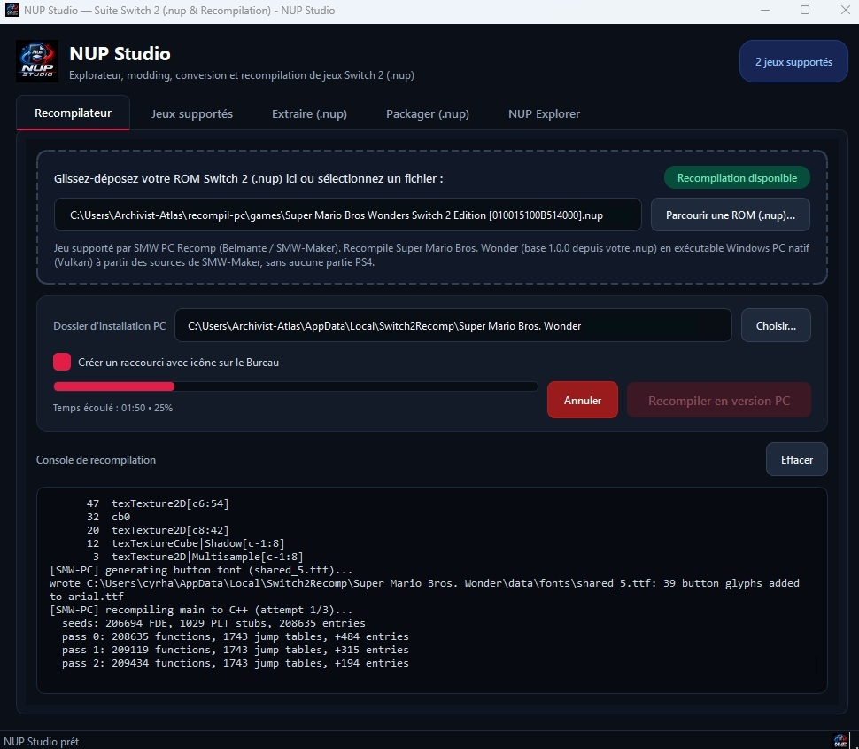
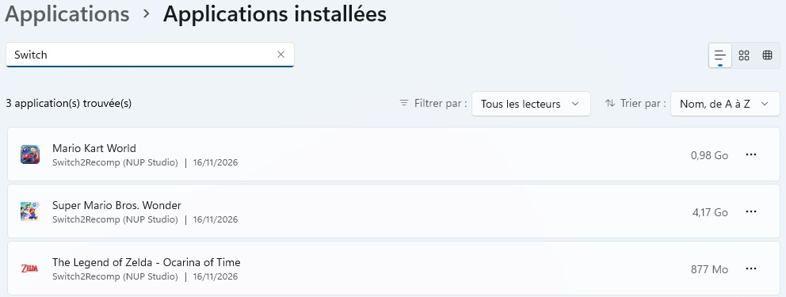
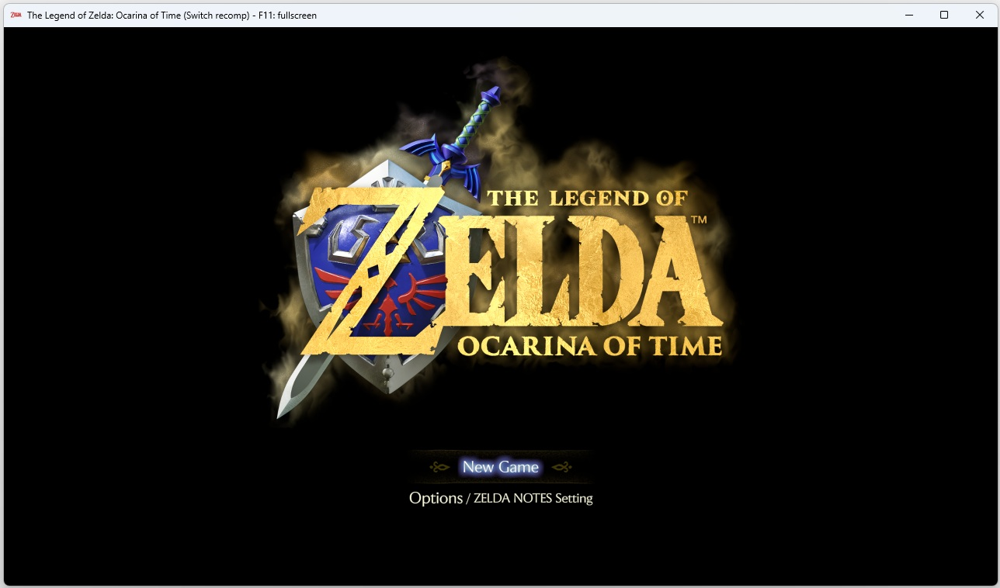
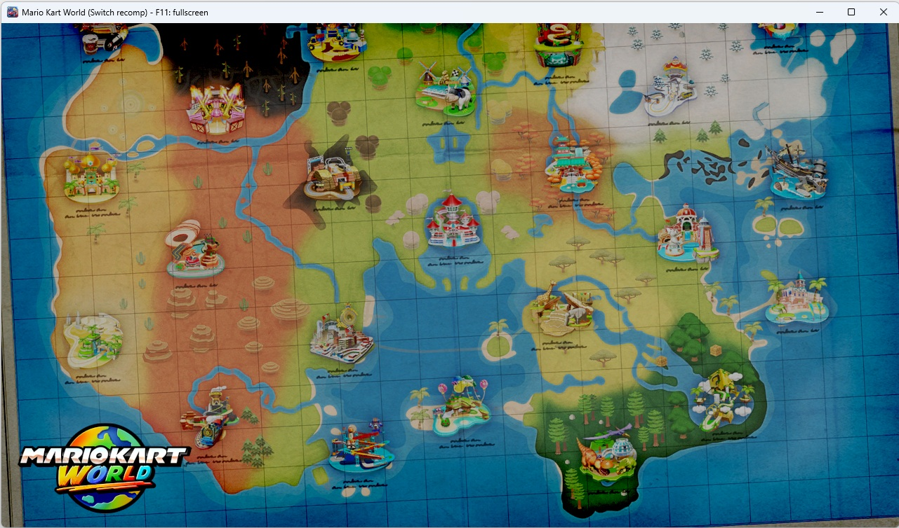
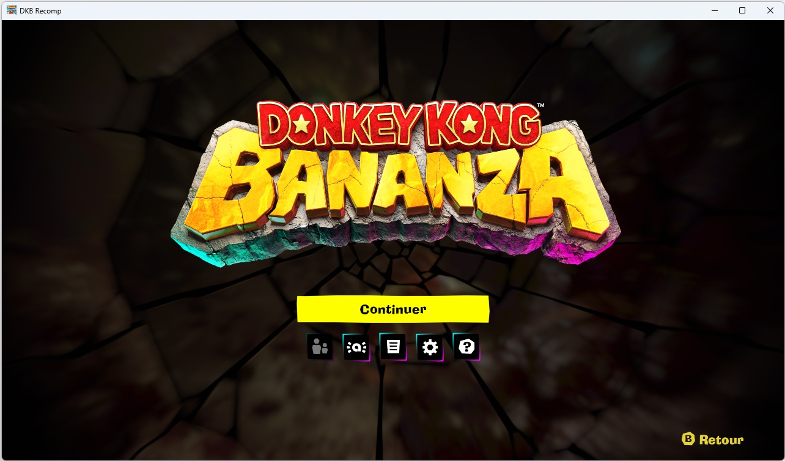
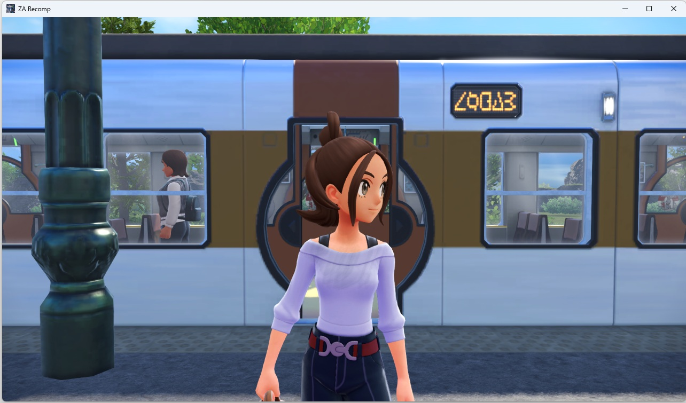

# NUP Studio — Switch2Recomp

Interface graphique Windows permettant d'explorer, extraire, packager des ROMs Switch 2 (`.nup`) et de les recompiler en exécutables PC natifs (Vulkan) lorsqu'un recompileur compatible est présent dans `tools/recompilers/`.

## Version compilé
<p align="center">
  
<i>plus besoin d'avoir Python d'installé sur votre système</i>
</p>

## Désinstallation possible depuis Windows
<p align="center">
  
</p>

-----------
## Super Mario Bros. Wonder
<p align="center">
  
</p>

## The Legend of Zelda: Ocarina of Time
<p align="center">
  
</p>

## Mario Kart World
<p align="center">
  
</p>

## Donkey Kong Bananza
<p align="center">
  
</p>

## Pokémon Legends: Z-A
<p align="center">
  
</p>


## Jeux supportés

| Jeu | Recompileur | Title ID(s) | Backend |
| :--- | :--- | :--- | :--- |
| **The Legend of Zelda: Ocarina of Time** | TOoT:R (The Ocarina of Time: Recomp) | `0400486024DEC000`, `0400486024DEC800` | SDL3 / Vulkan / FFmpeg |
| **Super Mario Bros. Wonder** | SMW PC Recomp (Belmante / SMW-Maker) | `010015100B514000` | SDL3 / Vulkan |
| **Mario Kart World** | mkw-recomp (adriadam10) | `0400C3F00006E000`, `0400C3F00006E800` | SDL3 / Vulkan |
| **Donkey Kong Bananza** | DKB Recomp (dkb-pc-recomp) | `040074A01BF12000`, `040074A01BF12800` | SDL3 / Vulkan |
| **Pokémon Legends: Z-A** | PokeZ-ARecomp (LASRecomp) | `0100F43008C44000`, `0100F43008C44800` | SDL3 / Vulkan |


## Fonctionnalités

- **Version compilée autonome (`dist/NUP Studio.exe`)** : utilisable directement sans installer Python ni ses dépendances (`tools/game_launcher.exe` inclus pour le lanceur de jeu).
- **Recompilateur** : glisser-déposer d'un fichier `.nup`, détection automatique du jeu et du recompileur associé, barre de progression, console temps réel et création de raccourcis (Menu Démarrer et Bureau).
- **Désinstallation intégrée à Windows** : chaque jeu recompilé apparaît dans *Paramètres → Applications installées* de Windows et peut être désinstallé en un clic (supprime le dossier du jeu et ses raccourcis tout en conservant le fichier ROM `.nup` et les sauvegardes).
- **Support des manettes sur tous les jeux** : prise en charge des manettes (Xbox, PlayStation, Switch, génériques via SDL3) sur l'ensemble des jeux recompilés.
- **Gestion centralisée des sauvegardes** : les sauvegardes sont stockées dans un dossier global `Saves/<NomDuJeu>` dans le répertoire parent d'installation (par exemple `Switch2Recomp\Saves\<Jeu>`), ce qui permet de les conserver même après désinstallation ou suppression du dossier du jeu.
- **Jeux supportés** : liste des recompileurs disponibles dans `tools/recompilers/` avec leurs Title IDs et versions compatibles.
- **Extraire (`.nup`)** : extraction du contenu d'une archive `.nup` (ExeFS / RomFS).
- **Packager (`.nup`)** : création et reconditionnement de fichiers `.nup` pour le modding.
- **NUP Explorer** : exploration des fichiers et prévisualisation des médias contenus dans une archive `.nup`.
- **Fenêtre de pré-lancement** : configuration graphique/audio avant démarrage du jeu recompilé (`tools/game_launcher.exe` / `src/game_launcher.py`).


## Prérequis

- **Windows 10 / 11** (64 bits)
- **Version compilée (`dist/NUP Studio.exe`)** : aucun Python requis pour utiliser l'interface et lancer les jeux (les recompileurs C++ utilisent leur propre toolchain ou MSYS2 Clang64 lors de la compilation initiale d'un jeu).
- **Mode sources Python (optionnel)** : Python 3.10+ avec `requirements.txt` (`PySide6 >= 6.6`, `zstandard >= 0.22`, `Pillow >= 10.0`).

## Installation et lancement

Lancez simplement `start.bat` (exécute directement la version compilée `dist/NUP Studio.exe`) :

```bat
start.bat
```

Pour reconstruire la version compilée :

```powershell
.\build_dist.ps1
```

Ou manuellement depuis les sources Python :

```bash
pip install -r requirements.txt
python main.py
```


## Avertissement

Ce projet ne contient aucun jeu, firmware, clé de chiffrement ni contenu protégé par le droit d'auteur. Vous devez fournir vos propres fichiers `.nup`.
