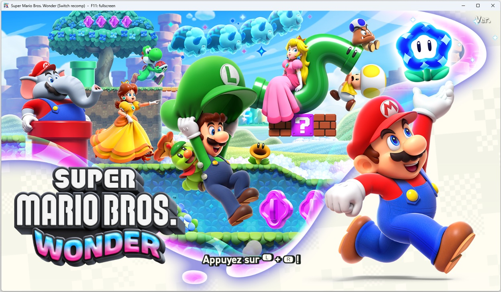

# NUP Studio — Switch2Recomp

Interface graphique Windows permettant d'explorer, extraire, packager des ROMs Switch 2 (`.nup`) et de les recompiler en exécutables PC natifs (Vulkan) lorsqu'un recompileur compatible est présent dans `tools/recompilers/`.

<p align="center">
  
</p>

<p align="center">
  
</p>

<p align="center">
  
</p>

## Fonctionnalités

- **Recompilateur** : glisser-déposer d'un fichier `.nup`, détection automatique du jeu et du recompileur associé, barre de progression, console temps réel et création de raccourci avec icône sur le Bureau.
- **Jeux supportés** : liste des recompileurs disponibles dans `tools/recompilers/` avec leurs Title IDs et versions compatibles.
- **Extraire (`.nup`)** : extraction du contenu d'une archive `.nup` (ExeFS / RomFS).
- **Packager (`.nup`)** : création et reconditionnement de fichiers `.nup` pour le modding.
- **NUP Explorer** : exploration des fichiers et prévisualisation des médias contenus dans une archive `.nup`.
- **Fenêtre de pré-lancement** : configuration graphique/audio avant démarrage du jeu recompilé (`src/game_launcher.py`).

## Jeux supportés

| Jeu | Recompileur | Title ID(s) | Backend |
| :--- | :--- | :--- | :--- |
| **The Legend of Zelda: Ocarina of Time** | TOoT:R (The Ocarina of Time: Recomp) | `0400486024DEC000`, `0400486024DEC800` | SDL3 / Vulkan / FFmpeg |
| **Super Mario Bros. Wonder** | SMW PC Recomp (Belmante / SMW-Maker) | `010015100B514000` | Windows PC natif / Vulkan |

## Prérequis

- **Windows 10 / 11** (64 bits)
- **Python 3.10+** disponible dans le `PATH`
- **MSYS2 (Clang64)** pour la compilation C++ native (`clang`, `clang++`, `cmake`, `ninja`)

Dépendances Python (`requirements.txt`) :
- `PySide6 >= 6.6`
- `zstandard >= 0.22`
- `Pillow >= 10.0`

## Installation et lancement

Lancez simplement `start.bat` (les dépendances Python manquantes sont installées automatiquement au premier démarrage) :

```bat
start.bat
```

Ou manuellement :

```bash
pip install -r requirements.txt
python main.py
```

## Structure du projet

```text
.
├── assets/                  # Icônes et capture d'écran de l'application
├── src/                     # Code source de l'interface NUP Studio et du lanceur de jeu
├── tests/                   # Tests unitaires (pytest)
├── tools/recompilers/       # Recompileurs par jeu (manifeste, script install.ps1, icônes)
├── games_db.json            # Base de correspondance des Title IDs
├── main.py                  # Point d'entrée de l'application
├── requirements.txt         # Dépendances Python
└── start.bat                # Script de lancement Windows avec auto-installation
```

## Avertissement

Ce projet ne contient aucun jeu, firmware, clé de chiffrement ni contenu protégé par le droit d'auteur. Vous devez fournir vos propres fichiers `.nup`.
